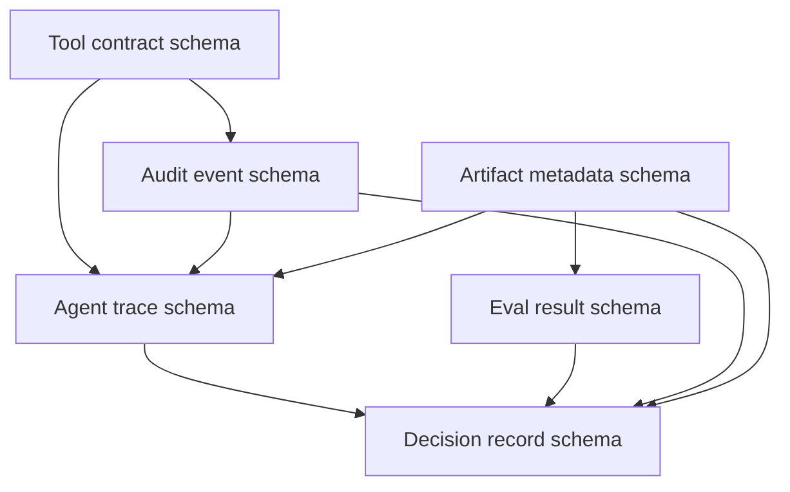

# Protocol dependency map

## Dependencies

## Как читать

- Tool contract определяет, что агент может сделать.
- Agent trace фиксирует, что агент сделал.
- Audit event фиксирует accountability и policy decision.
- Artifact metadata связывает результаты в lineage.
- Eval result проверяет candidate changes.
- Decision record принимает или отклоняет изменение на основе evidence.

## Critical path для release

1. Artifact metadata для candidate.
2. Eval result с baseline.
3. Agent trace или experiment evidence.
4. Audit events для dangerous actions.
5. Decision record с rollback path.
