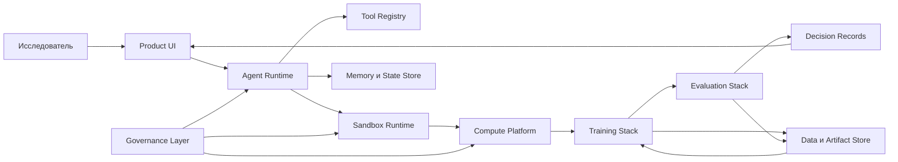

# Компоненты системы

## Верхнеуровневая схема

## Компоненты

- Product UI - рабочая поверхность исследователя.
- Agent Runtime - цикл планирования, tool calls, state и trace.
- Tool Registry - контракт и policy для внешних действий.
- Sandbox Runtime - изоляция AI-generated code.
- Compute Platform - CPU/GPU clusters, scheduler, quotas.
- Training Stack - pretraining, post-training, RL.
- Evaluation Stack - evals, verifiers, regression detection.
- Data и Artifact Store - datasets, checkpoints, traces, reports.
- Governance Layer - identity, audit, approval, retention.

## Инварианты

- Нет действия без actor.
- Нет artifact без lineage.
- Нет release без eval gate.
- Нет tool call без policy.
- Нет dangerous action без approval или explicit allow rule.
