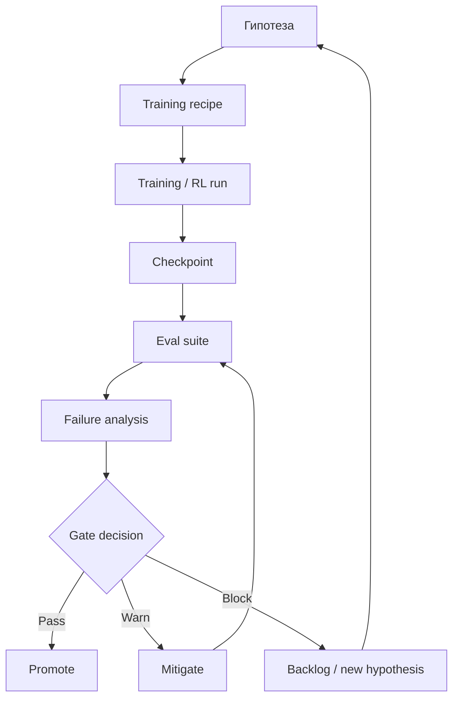

# Training и evaluation loop

## Назначение

Связать training, post-training, RL environments, evals и release decisions в один управляемый цикл.

## Поток

## Контракты

- Training run должен указывать data version, code version, config, compute profile.
- Checkpoint должен иметь owner, lineage, integrity check и access policy.
- Eval suite должен иметь version, leakage controls и baseline.
- Gate decision должен иметь owner, evidence и rollback path.

## Метрики

- Capability score.
- Regression count.
- Verifier pass rate.
- Cost per accepted improvement.
- Time from hypothesis to decision.
- Failure recurrence rate.

## Риски

- Eval overfitting.
- Reward hacking.
- Неполный lineage.
- Promotion без rollback.
- Игнорирование latency и cost regression.
